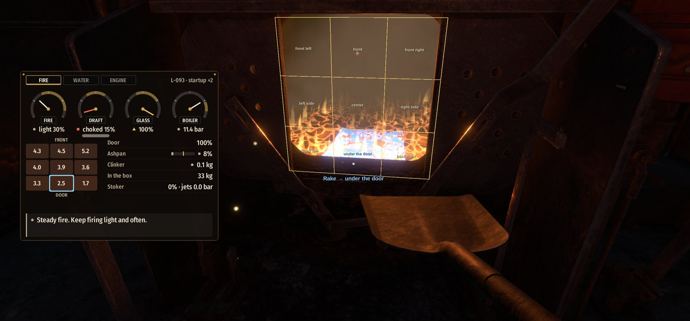

# Firing guide

How to fire well with Realistic Firing: steady steam, a clean stack, and the
least coal or oil. For what each control does, see the README.

## The habits that matter most

- **Fire ahead of the work.** Fresh coal takes about half a minute to catch,
  and an oil fire answers in a second or two. Build the fire up before a
  grade or a heavy start, and ease off before you shut off.
- **Fire light and often.** A few shovelfuls at a time burn clean. A heavy
  round smokes, chills the fire while it warms, and banks up.
- **Keep the door shut.** Crack it briefly after firing to burn off the
  smoke, then close it. Cold air through the door wastes more heat than air
  through the grate.
- **Read before you act.** The tablet and optional F6 overlay show the fire,
  the draft (choked when
  overstoked, thin when underfed, the smoke's color under it), the glass,
  and the boiler on dials, each grate zone's coal, and the next thing to do.
  The stack and the bed tell you the rest.
- **Keep the water in the middle of the glass.** Feed steadily, not in
  floods, and never let it get low.

## The tablet and automatic fireman

Carry the firing tablet or fit it to a large gadget mount in the cab. Steam
starting equipment that includes a shovel includes a tablet too; buy one
beside the clinometer or use **Controls → Equipment → Give firing tablet**
in the mod's settings (F8). Each tablet saves its selected page. On desktop,
use mouse mode to press the tabs and buttons while holding it.

The **Fire**, **Water**, and **Engine** pages show the readings and advice
also available through F6. A mounted tablet reads its engine; a held tablet
reads the engine you are tending. Between two locomotives, the readings
prefer the engine you were last in.

Open **Fireman** to give the automatic fireman orders:

- **Off:** you do the firing and feeding.
- **Keep It Alive:** a thin fire and about half pressure for a long stand.
- **Shunting:** pressure ready for stop-start work, clear of the safety valve.
- **Road:** pressure just under the safety valve for road work.

Before a pull, press **Heavy Work Ahead** to build the fire and fill the
boiler. Before shutting off or stopping, press **Easing Off** to let the
fire burn down and fill the boiler. Press an active call again to cancel
it. The page shows his status and warnings; F7 still opens the separate
fireman controls.

You can take over a control he is working: move it and it is yours for a
minute. A new order hands the controls back. He handles stoker feed, jets,
jams, and retained table coal, but you still light the fire, break clinker,
and empty the ashpan. Check which engine the tablet is reading before
giving an order.

## Hand firing coal

**Shape the fire to the draft.** Under a brick arch the back of the grate
and the back corners draw the most air, then the sides, and the front under
the arch the least, so an even fire burns through at the back corners and
under the door first. Keep those fuller (heaviest at the sides and back
corners), and the air spreads forward. On a sloping grate the coal also
creeps forward at speed, so the back wants it all the more. A bare patch
takes about three times its share of air and chills the fire: fill holes
before anything else.

**Aim each shovelful** where the overlay shows the coal running short, by
where you point in the open firehole, read like a keypad: the top third
throws to the front (left, middle, right), the middle third to the sides
and center, the bottom third to the back corners and under the door. The
zone is named under the crosshair, and the keypad is drawn on the door as
you aim (a setting turns it off). If you'd rather aim at the spot on the
fire you look at, set **Firing → Aiming method** to **Grate** (F8); on some engines the
front of the box is out of sight through the door.

Rake a bank level with the empty shovel; don't stir it.

**Read the bed and the stack.**

- Bright, even, yellow-white bed, light haze at the stack: right. Burning
  clean with air to spare, the stack shows almost nothing but heat
  shimmering over it.
- Grey exhaust steam: smoke riding in it, the start of black smoke.
- Dark lumps: green coal still catching. Wait before firing more there.
- Black smoke: more fresh coal than the air can burn. Crack the door or fire
  lighter.
- Dull red bed: ash. Shake the grate.
- Dark patch that won't brighten: clinker (see below).

**Wet coal.** Rain soaks the coal in an open tender or bunker, and it dries
again over an hour or so once the weather does. Wet coal catches slower and
spends heat drying, so the fire steams a little less: fire a little more,
lighter and more often, and give each charge time to catch. The overlay's
fire page shows how wet the coal is. Fresh coal from the coaling stage comes
dry. The Hudson's tender has a coal bunker door: keep it shut in the rain
and its coal stays dry.

**Raising steam.** A cold boiler's water must boil before the gauge moves;
the overlay's boiler dial shows its temperature until then. The water swells
as it heats, rising about a sixth of the glass: fill a cold boiler low. The game's Steam
Startup setting speeds up a cold fire (×25 at 100 %). Set it to 2500 % for a
real-time light-up. At a roundhouse stall or engine shed, plug the stand's
blower line into the fitting on the smokebox and open its handwheel a
little as you lay the fire, more as it catches; take it off at about 50 psi
and use the cab's blower (the 8F has no fitting).

### Each engine

- **S282:** draws hardest at the back, and the grate slopes forward, so at
  speed the fire creeps off the back corners. Fire the back and back
  corners heavy, the front light.
- **S060:** a small box that draws nearly evenly and smokes readily. Keep a
  thin fire, fired light and often.
- **JK3:** a small, long, level 70 kg box with a modest pull to the front.
  Fresh rounds smoke readily: fire small amounts often and keep the front
  covered. Two lifting injectors, each with its own water valve and steam
  lever: the priming steam lifts the water. Each delivers up to 2.5 kg/s at
  rated pressure, enough for the boiler alone; 5 kg/s together.
- **LMS 8F:** a narrow Belpaire box, sloping at the front and level at the
  back, with a brick arch. Fire thin and often, a few shovelfuls at a time,
  and keep the back corners filled; a heap under the door chokes it. Two
  live-steam injectors, one each side: the handles on the backhead are the
  steam valves, the water regulators are under the seats (the fireman's a
  handwheel, the driver's a handle; anticlockwise opens), and the tender
  water valves on the tender front must be down at OPEN. Water first, then
  steam to Prime, then Feed.
- **NYC Hudson:** the back corners thin out at speed, and the stoker runs the
  right back corner short. Its coal leaves a little more ash and clinker.
- **844:** burns its smoke clean and draws more evenly than most, its arch
  having a generous way over it. Its coal hardly clinkers. The stoker
  starves both back corners.
- **S484-840:** the same firebox as the 844, with ordinary coal. Its stoker
  reaches the back corners.

## Keeping the fire clean

- **Wiggle the grate** (a short rock of the fire-dump lever, or Z) every
  10–15 minutes of hard work. It takes the ash and almost no fire.
- **Shake it** (a half stroke) when the fire turns dull and red, ideally
  with the throttle eased. Shaking hard while working throws fire and
  sparks out of the stack. Shaking every few minutes only wastes coal.
- **Clinker** shows as a dark patch that won't burn up. Regular wiggling
  keeps a hard-worked fire clean for about two hours. A thick ash bed, a thin
  forced fire, or stirring with the irons brings it on sooner.
- **Clean a clinkered fire at a stop:** pull the live fire back from the
  front, slice the front and middle with the fire iron, push the broken
  clinker forward, open the drop grate for a few seconds, shut it, spread
  the fire, and fire a few shovels.
- **Empty the ashpan at half full** (the overlay shows it). A full pan chokes
  the fire. From outside, a bright glow under the engine means clean grates.

## Stoker (S282 if fitted, NYC Hudson, 844, S484-840)

- **Start** with steam up: floor lever at Forward, open the stoker engine
  valve, and set the feed to hold the coal steady.
- **Jets:** start at master 1.4 bar, front 1.2, back 0.8, fines 0.7. Turn
  the front and fines down as the engine works harder; the draft carries
  coal forward anyway. The back draws hardest and the stoker can't reach it
  all: keep the back corners up by hand.
- **What each jet does** (each gauge reads its own pressure; MASTER feeds
  them all):
  - **FRONT** (left and right) throw most of the coal up their side of the
    grate, farther the harder they blow: about 1.2 bar lays it from the
    middle to the front, 1.6 reaches the front row, and past about 2.4 it
    banks against the tubeplate and goes over the arch.
  - **BACK** blow a small lane sideways into the back corners: about 0.8 bar
    reaches them. Lower, the coal drops under the door; much higher, it
    spills into the middle.
  - **FINES** spread the fine quarter of the coal evenly over the grate at
    about 0.7 bar. Lower, they fall under the door; higher, they blow over
    the arch. Working hard, the draft lifts some fines straight out of the
    stack whatever you set: cinders, and less heat from each kg.
- **Read the bed and set the jets:**
  - Coal **piling at the front**, sparks and black smoke from the stack:
    front jets down, all the more as the engine works harder.
  - **Front running thin:** front jets up a little.
  - A **heel under the door:** back jets or fines too low, or shut; their
    coal drops off the plate. Open them up.
  - **Back corners thin:** back jets up, or fire them by hand.
  - **Look through the door:** the coal blows off the plate in lanes, the
    back jets' sideways into the corners, the front jets' up each side;
    each jet's steam shows how hard it blows, and the fines catch and burn
    in the air.
- **Wet coal and fines:** a little dampness binds fines and reduces dust
  and cinders. Soaked coal catches more slowly, sticks on the distributing
  table, and can pack the screw. Delivery can slow before a stall. Dry coal
  gradually scours packing away; a short reverse relieves the screw.
  Persistent packing is disabled when jams are off.
- **Match feed to the jets.** More coal needs more jet steam to throw it.
  Ease the feed or raise the jets a little when the coal falls short.
  Turning one jet down affects its own lane; watch where that coal lands.
- **Coal held on the table:** the tablet's Fire page and F6 show the amount
  retained and advise when it needs clearing. Open the door and rake the
  back of the fire with the empty shovel, or slice, push, or pull there
  with the fire iron. This moves coal onto the grate and scrapes the plate,
  even when empty. Reversing relieves the screw, not the table. A hot table
  wears clean as dry coal replaces the wet mixture.
- **After stopping:** with the screw stopped and jets shut, coal stays on
  the table until the jets or the hook move it. A little retained coal
  while standing is normal; it and its water are saved with the engine.
  The automatic fireman attends to loaded tables and a heavily loaded or
  jammed screw.
- **Fire the back corners and under the door by hand.** The stoker runs them
  short.
- **Don't stoke standing.** With no draft it banks the fire and smokes. Shut
  the stoker and the master jet when you stop.
- **Jammed** (coal stops, gauge pegs): floor lever to Reverse for a few
  seconds, then Forward.

## Oil (Santa Fe 2901)

- **Oil temperature first.** Keep it at 45–80 °C (110–175 °F). Below about
  20 °C it won't run at all; above 80 °C it sputters and smokes. Run the
  heater strong to warm it, then turn it down.
- **Light up in order:** blower on to clear the firebox, atomizer open a
  little, then your lighter, lit, held at the open fire door (it stands for
  lit waste and burns 25 seconds), and within that the firing valve opened a
  little. Never let oil run in with the fire out: lighting into vapor or
  pooled oil flares back.
- **Match the atomizer to the oil.** Open it more as you fire harder and work
  harder. Through the peep hole: smoky orange and spitting means too
  little; steady yellow-white is right; a throbbing drum is too much.
- **Read the stack:** a light grey-brown haze is right and makes the most
  steam. Black is too much oil for the air. Thin white steam is too much air
  and wastes oil.
- **Lead the throttle:** raise the fire just before you open up, cut it just
  after you shut off. A light fire on cold brick blows out if you slip the
  drivers or open the throttle suddenly.
- **Set the stop** for the drifting fire: with the firing valve where the
  fire holds lit with the throttle shut, click it. Then you can cut the fire
  hard to the stop without putting it out. Click again to take it out.
- **Sand the flues** when steaming falls off after smoking: click the sand
  box on the cab floor (by the fire door, fireman's side) with the empty
  shovel to load a quart of sand, open the peep hole, and throw it in while
  working hard. Black clouds at the stack mean it's scouring.
- **A dead engine** fires up on the shed's steam at a roundhouse stall or
  engine shed (tow it there): plug the stand's blower line into the
  fitting on the smokebox and open the stand's valve (it feeds the blower,
  atomizer, and heater), warm the oil for about ten minutes, light up, and
  take the line off at about 20 psi. The screen says each next step.

## Water

- **Injectors:** with at least 2.5 bar, open the water valve (the injector
  lever), then the steam lever to Prime; when the overflow quiets, steam to
  Feed. Opened to Feed too soon, the jet breaks. A hot injector won't take:
  hold it at Prime to cool it. Stopping, steam Off, then shut the water.
- **Feed steadily** with the water valve: it turns down only to about two
  fifths open (a little more at full pressure); below that it wastes a
  trickle of water at the overflow. Run it continuously, set to what the
  engine boils off, and watch which way the glass moves rather than
  flooding and stopping. Before a hard pull carry the water high; on the
  pull, if steam falls short, let the glass come down a little and fill it
  again over the top.
- **Swell and shrink:** boiling hard, the water carries steam and the glass
  stands a little above the water itself. It jumps when you open up and the
  pressure falls, and drops when you shut off, the pressure rises, or cold
  feed goes in. Carry it high enough before shutting off that the drop
  still leaves water over the crown sheet.
- **Keep the tubes clean:** a smoky fire soots them and steaming falls off;
  working hard on a clean fire scours them. Hard water scales the boiler
  slowly. Both show on the overlay's Water page, count as engine wear, and
  are cleaned by repairing the engine at a service station.
- **Drifting:** throttle shut, put the reverser down to full gear (or keep
  the throttle cracked). Hooked up, the engine sucks smokebox grit into its
  cylinders and wears.
- **Allow for stored steam:** closing the throttle does not empty the pipes
  and steam chest. Watch the chest pressure as the engine uses that steam;
  see [Throttle characteristics](#throttle-characteristics).
- **Don't run the tender dry:** nearly empty, a climb or a hard start runs
  the water off the outlet and the injectors lose it until it runs back.
- **Feed pump and heater** (Hudson, 844, S484-840, 2901): start on the
  injector, then switch to the pump once the engine has worked a few
  minutes. It feeds hot water and holds the pressure better. Ease it before
  you shut off.
- **Blow down** in short bursts, about three seconds open and five or six
  shut, especially when starting after standing. About a sixth of what you
  feed keeps average water from foaming.
- **Foaming** (the glass bobs and reads high): ease the throttle, open the
  cylinder cocks, and lower the water. Water in the exhaust means it's
  carrying over and can crack a cylinder.
- **Wash out** with a shed stand's water hose (boiler cold) when blowdowns
  no longer keep it quiet.
- **Never run low.** A bared crown sheet melts the fusible plug and kills the
  engine (S282, S060, S484-840, 844) or bursts the boiler (Hudson, which
  whistles a warning with an inch left). A repair or a washout at a pit
  stop renews the plug. The JK3 keeps the game's own low-water failure.
- **A damaged engine bursts lower.** Badly damaged, its boiler bursts under
  the safety valve; the overlay warns at what pressure. Keep under it and
  get the engine repaired. The automatic fireman holds 1.5 bar under it.

## Running

- **Notch up at speed.** A short cut-off holds its pressure and pulls hard
  for the least steam. A long cut-off at speed takes more steam than the
  throttle passes.
- **Work the fire to the job.** Heavy pulls at a long cut-off need a strong
  fire and full draft. Drifting needs only a light fire: hold it, don't
  build it.
- **Bailing off moved to [Realistic Brakes](https://www.nexusmods.com/derailvalley/mods/1798)
  in 1.16.2.** Install that optional mod to keep the bail-off feature.

## Throttle characteristics

**The handle controls fresh steam; the chest pressure tells you what is
available to the cylinders.** Opening the throttle fills the spaces between
it and the cylinders. If those spaces have lost pressure, the pull takes
time to build. Closing the throttle stops the supply but does not vent the
steam already beyond it. That steam can keep the engine pulling and beating
as the wheels turn. Reopening before it is used up starts from the pressure
still there.

The throttle's position relative to the superheater changes which spaces
hold that steam:

- **Regulator before the superheater:** boiler → regulator → superheater
  and pipes → steam chest → cylinders. Closing the regulator leaves the
  steam in the superheater and pipes connected to the chest.
- **Front-end throttle after the superheater:** boiler → superheater →
  throttle → steam chest → cylinders. Closing it separates the superheater
  from the cylinders, but the pipes and chest beyond the throttle still
  contain steam.

| Engines in this test build | Throttle arrangement |
| --- | --- |
| S282 (provisional), LMS 8F | Before the superheater |
| NYC Hudson (provisional), 844, S484-840, 2901 | After the superheater |
| S060, JK3 | Existing response; no added superheater steam-storage model |

These test fits retain each maker's chest and throttle capacity and add a
separate, provisionally sized superheater circuit. On the S282 and 8F,
that circuit fills when the regulator opens and runs down with the chest
after closing: allow for a gradual change in pull. A front-end throttle
isolates the charged circuit from the cylinders, so it answers sooner
under comparable conditions. These are tuning profiles, not measured
prototype response times. The S282 and Hudson arrangements remain
provisional.

**Give a change time to take effect.** Open gradually and watch the chest
pressure before adding more throttle. Close ahead of the point where you
want the pull to end. How quickly the engine answers depends on the steam
space, pressure, speed, and cut-off; the mod does not impose a fixed delay.
A long cut-off at speed uses steam quickly and may pull the chest pressure
down even with good boiler pressure. Notch up rather than assuming more
throttle will always cure it.

**Superheater warm-up is a separate effect.** The elements heat up with the
fire and steam flow over minutes. Cold steam condenses more on the cylinder
walls, so a cold engine uses more steam for its work. The tablet or F6's
**Engine** page shows the steam-chest pressure and superheat. Pressure
building after a throttle movement and temperature building as the engine
warms are two different things.

When drifting with the throttle shut, still put the reverser in full gear
or keep the throttle cracked. Stored steam running out does not remove the
wear from drifting hooked up.

Turning off **Realistic cylinders** restores the game's throttle response
and disables the mod's cylinder and superheater behavior.

## Booster (NYC Hudson)

A small engine on the trailing truck that adds about 12,100 lb of pull for
starting and slow running. Its controls are on the wall by the reverser:
the IDLING VALVE wheel, the BOOSTER LATCH, and the BOOSTER gauge.

**Cutting it in:**

1. **Warm it.** Open the IDLING VALVE. The booster turns over slowly out of
   gear, its gauge shows about 2.4 bar, and the valve reads "Idling (latch
   locked out)" with how warm it is. Give it two or three minutes, until it
   reads 90 % or more. Cut in under half warm and it primes: a third of its
   pull for the first ten seconds.
2. **Shut the IDLING VALVE.** It reads "Running". Wait about ten seconds for
   the booster to stop turning.
3. **Set the engine up.** Standing or under 12 mph going forward, reverser
   in the forward corner (66 % cut-off or more), throttle open.
4. **Raise the BOOSTER LATCH.** The cylinder cocks blow for about 20
   seconds, then it pulls. The gauge shows its steam.

**Cutting it out:** hook the reverser back short of 66 %, or knock the
latch down. Cut it out before 21 mph.

**If the latch drops back down:**

- The IDLING VALVE is still open: the latch is locked out while it idles.
- The booster is still turning: wait after shutting the idling valve.
- You're over 12 mph, or rolling backward: it never drives backing up.
- The reverser is short of the forward corner.

A grinding clash means the booster was turning or you were going too fast.

## Quick reference

| What | Target |
| --- | --- |
| Shovelful | 3 kg; a few at a time |
| Fresh coal catches | about 30 s: fire ahead of the work |
| Wiggle the grate | every 10–15 min of hard work |
| Clean the fire | when clinker shows, about every 2 h of hard work |
| Ashpan | empty at half full |
| Fireman orders | tablet's Fireman page, or F7; Heavy Work Ahead before a pull, Easing Off before stopping |
| Stoker jets | master 1.4, front 1.2, back 0.8, fines 0.7 bar |
| Stoker coal piling | at the front: front jets down; under the door: back jets and fines up |
| Coal held on the table | door open; empty-shovel rake or fire-iron slice, push, or pull at the back; reverse clears the screw |
| Oil temperature | 45–80 °C (110–175 °F) |
| Oil stack | light grey-brown haze |
| Injector | at least 2.5 bar; water open, steam Prime, then Feed; water past two fifths |
| Blowdown | 3 s open, 5–6 s shut; about a sixth of the feed |
| Booster (Hudson) | idling valve open 2–3 min, shut it, wait 10 s; under 12 mph, reverser forward, throttle open: raise the latch |
| Water | middle of the glass |
